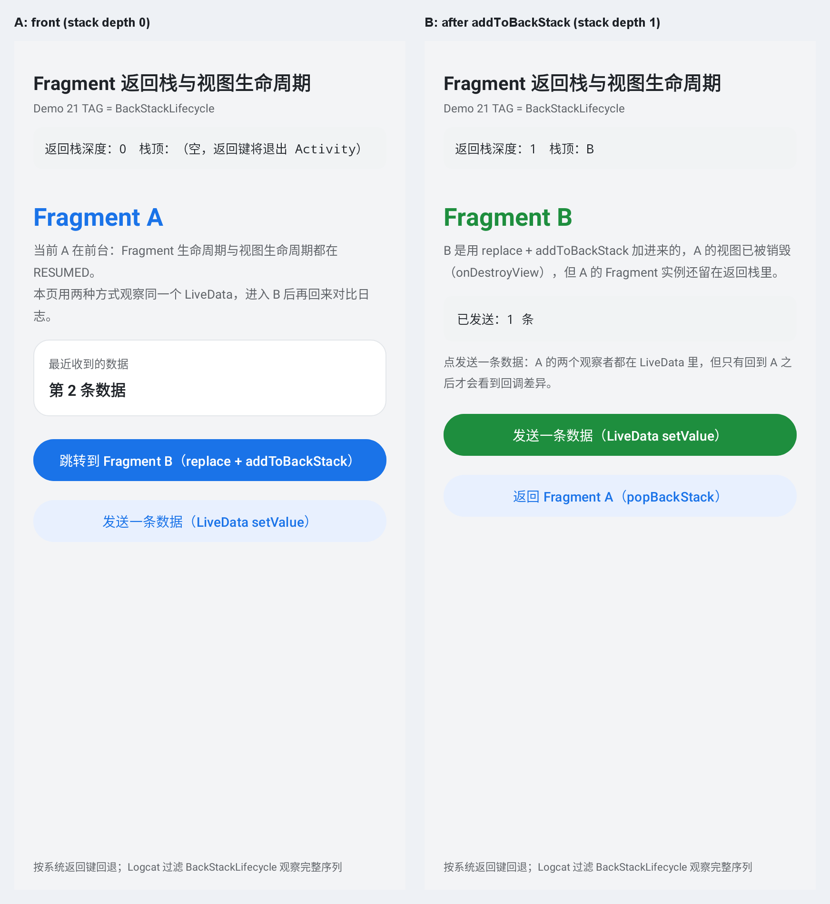

# Ch07_07_BackStackLifecycle

> 微型 Demo 清单（第三批次）· 第 21 项 · **Demo 21　Fragment 返回栈与视图生命周期**

| 项目 | 内容 |
| --- | --- |
| 姓名 / 学号 | 周皓琪 / 20250551421 |
| Demo 序号 | 21 |
| 工程名称 | Ch07_07_BackStackLifecycle |
| 开发语言 | Java（XML + View，未使用 Kotlin、未使用 Compose） |
| 统一日志标签 | `BackStackLifecycle` |
| 最低运行版本 | Android 7.0（API 24） |

## 一、任务目标

掌握 `addToBackStack` 的行为，以及用 `getViewLifecycleOwner()` 观察数据的正确姿势，避免**重复观察**与**内存泄漏**。

本 Demo 只用两个 Fragment（A、B）和一个 Activity 作用域的 `ViewModel`，把两件事用日志说明白：

1. **返回栈场景**：A → B → 返回 A，每一步的 Fragment 生命周期与视图生命周期到底按什么顺序走；
2. **观察者对照**：同一个 `LiveData`，分别用 `getViewLifecycleOwner()` 和 `this`（Fragment 自身）去 `observe`，差异在哪。

## 二、使用的组件及作用

| 组件 / API | 作用 |
| --- | --- |
| `FragmentTransaction.replace + addToBackStack("B")` | 用 B 替换 A，并把这次事务压入返回栈，使返回键可以回退 |
| `FragmentManager.getBackStackEntryCount()` | 观察返回栈深度，实时显示在页面顶部 |
| `addOnBackStackChangedListener` | 入栈 / 出栈时打印栈深度与栈顶 |
| `Log.d(TAG, …)` | 统一标签 `BackStackLifecycle` 输出 Fragment 全部生命周期回调 |
| `LiveData.observe(getViewLifecycleOwner(), …)` | **正确写法**：跟随视图生命周期 |
| `LiveData.observe(this, …)` | **错误对照**：跟随 Fragment 生命周期 |
| `ViewModelProvider(requireActivity())` | 让 A、B 共用同一个 `SharedViewModel` |
| `Button` | A 页：跳转 B、发送数据；B 页：发送数据、返回 A |
| `OnBackPressedDispatcher` | 系统返回键：栈非空时由 FragmentManager 拦截回退，栈空时结束 Activity |

## 三、运行步骤

1. 用 Android Studio 打开本目录（`File → Open` 选 `Ch07_07_BackStackLifecycle` 文件夹）。
2. 等待 Gradle Sync 完成（首次会下载 Gradle 9.6.0 与依赖，已配置国内镜像）。
3. **先打开 Logcat**，过滤 `BackStackLifecycle`，级别选 Debug。
4. 运行 App，按下面顺序操作，边操作边看日志：

```
点「跳转到 Fragment B」→ 点「发送一条数据」→ 点「返回 Fragment A」
→ 点「发送一条数据」→ 再进 B → 按系统返回键 → 在 A 上再按返回
```

命令行编译：`gradlew.bat assembleDebug`，产物在 `app/build/outputs/apk/debug/`。

## 四、核心代码说明

### 1. 入栈：replace + addToBackStack

```java
getParentFragmentManager()
        .beginTransaction()
        .replace(R.id.fragmentContainer, new FragmentB(), "B")
        .addToBackStack("B")   // 关键：把这次事务压栈，A 的视图被销毁但实例保留
        .commit();
```

`replace` 一定会让 A 走 `onDestroyView`；`addToBackStack` 的作用是**把 A 的 Fragment 实例留在栈里**（状态退回 CREATED），等 `popBackStack()` 时再按 `onCreateView → onViewCreated` 重建视图。这就是"返回栈"和"视图"两回事的根源。

首次添加 A 时**不入栈**：

```java
getSupportFragmentManager().beginTransaction()
        .replace(R.id.fragmentContainer, new FragmentA(), "A")
        .commit();
```

所以 A 上按返回键会直接结束 Activity（返回栈深度为 0）。如果把首次 A 也入栈，按返回会退出到"空容器"，出现白屏——这是常见坑。

### 2. 两组观察者对照（本 Demo 的核心）

两个观察者都写在 `FragmentA.onViewCreated()` 里，**唯一区别是 LifecycleOwner**：

```java
// ① 正确：跟着视图走
viewModel.getMessage().observe(getViewLifecycleOwner(), value -> {
    tvLastMessage.setText(value);
});

// ② 错误示范：跟着 Fragment 走
viewModel.getMessage().observe(this, value -> {
    Log.d(TAG, "[A][this] 收到 = " + value + "，getView() = " + (getView() == null ? "null" : "非空"));
});
```

因为都写在 `onViewCreated()`，每次视图重建都会执行一次 `observe()`。区别在于：

- `getViewLifecycleOwner()` 返回的 LifecycleOwner 与**这一次的视图**绑定，视图销毁（`onDestroyView`）时它的状态变成 DESTROYED，LiveData 会自动移除观察者；
- `this`（Fragment）的状态要等整个 Fragment 销毁才变 DESTROYED，**进返回栈时它只回到 CREATED**，所以那个旧的观察者一直挂在 LiveData 上不被移除。

### 3. 观察者数量的证据

`LiveData` 的 `getObserverCount()` 在 lifecycle 2.8 里对 Java 不可见（编译不过），所以在 `SharedViewModel` 里自己计数：每次 `observe()` 之前调用 `onObserveRegistered(who)`，计数只增不减。

## 五、记录一：返回栈场景的生命周期序列

以下内容全部来自本工程实际运行输出的日志（完整原文见 [`docs/lifecycle-log.txt`](./docs/lifecycle-log.txt)，`===== ① …` 分段与下表一一对应）。

### ① 启动，A 首次进入

| 顺序 | 日志 |
| --- | --- |
| 1 | `[A] onAttach` |
| 2 | `[A] onCreate` |
| 3 | `[A] onCreateView` |
| 4 | `[A] onViewCreated` |
| 5 | `[A] onStart` |
| 6 | `[A] onResume` |

### ② 点「跳转到 B」：A 的视图被销毁，但 A 只到 CREATED

| 顺序 | 日志 | 说明 |
| --- | --- | --- |
| 1 | `[A] onPause` | A 让出前台 |
| 2 | `[A] onStop` | |
| 3 | `[B] onAttach` | B 开始创建 |
| 4 | `[B] onCreate` | |
| 5 | `[B] onCreateView` | |
| 6 | `[B] onViewCreated` | |
| 7 | `[B] onStart` | |
| 8 | **`[A] onDestroyView`** | **视图销毁，但 Fragment 实例留在返回栈** |
| 9 | `[B] onResume` | |
| 10 | `[FragmentManager] 返回栈深度 = 1，栈顶 = B` | |

注意第 8 步的位置：A 的 `onDestroyView` 在 B 起来之后才执行，而 A 并**没有**走 `onDestroy`——这就是"Fragment 还活着，视图已经没了"。

### ③ 在 B 里发数据

| 顺序 | 日志 |
| --- | --- |
| 1 | `[ViewModel] setValue(第 1 条数据)，历史累计注册观察者 = 2` |

**A 的两个观察者都没有回调**：`[viewLifecycleOwner]` 已随视图销毁解绑；`[this]` 虽然还挂在 LiveData 上，但 A 处于 CREATED、未达 STARTED，LiveData 不派发（这就是"泄漏不崩、但也不干活"的隐蔽之处）。

### ④ 点「返回 A」：popBackStack

| 顺序 | 日志 | 说明 |
| --- | --- | --- |
| 1 | `[B] onPause` | |
| 2 | `[B] onStop` | |
| 3 | `[A] onCreateView` | A 视图重建 |
| 4 | `[A] onViewCreated` | |
| 5 | `[ViewModel] 注册观察者 A[viewLifecycleOwner]，累计注册次数 = 3` | 又注册一次 |
| 6 | `[ViewModel] 注册观察者 A[this]，累计注册次数 = 4` | 又注册一次 |
| 7 | `[A] onStart` | |
| 8 | **`[A][this] 收到 = 第 1 条数据`** | **两次！** |
| 9 | **`[A][this] 收到 = 第 1 条数据`** | ↑ 重复回调 |
| 10 | `[A][viewLifecycleOwner] 收到 = 第 1 条数据` | 只有一次 |
| 11 | `[B] onDestroyView → onDestroy → onDetach` | B 被真正移除 |
| 12 | `[A] onResume` | |
| 13 | `[FragmentManager] 返回栈深度 = 0，栈顶 = （空）` | |

第 8、9 行是**重复回调**的直接证据：A 只收到了 1 条数据，却打印了 2 次，因为第一个视图注册的 `[this]` 观察者没有被释放，回到前台时和新的观察者一起被激活，并立刻收到粘性数据。

### ⑤ 再次发数据（A 在前台）

| 日志 |
| --- |
| `[ViewModel] setValue(第 2 条数据)，历史累计注册观察者 = 4` |
| `[A][this] 收到 = 第 2 条数据`（×2） |
| `[A][viewLifecycleOwner] 收到 = 第 2 条数据`（×1） |

### ⑥⑦⑧ 再进 B、系统返回、栈空退出

| 场景 | 关键日志 |
| --- | --- |
| ⑥ 再进 B | 与 ② 完全一致，返回栈深度 = 1 |
| ⑦ 系统返回键 | 与 ④ 一致：B 走 `onDestroyView/onDestroy/onDetach`，A 重建视图，累计注册次数涨到 **6**，`[A][this]` 又是 2 次、`[A][viewLifecycleOwner]` 1 次 |
| ⑧ 在 A 上再按返回 | 返回栈深度 = 0，`activity.isFinishing() = true`，即栈空时返回键交给 Activity 处理 |
| ⑨ 销毁 | `[A] onPause → onStop → onDestroyView → onDestroy → onDetach` → `[Activity] onDestroy` |

## 六、记录二：两种观察者的差异说明

| 对比项 | `observe(getViewLifecycleOwner(), …)` | `observe(this, …)`（错误） |
| --- | --- | --- |
| 绑定的生命周期 | **视图**：onCreateView → onDestroyView | **Fragment**：onAttach → onDetach |
| 进返回栈时 | 随 `onDestroyView` 自动解绑，不再回调 | 不解绑，观察者继续挂在 LiveData 上 |
| 返回 A 时 | 新视图注册 1 个，旧的已被移除 → **每次数据只回调 1 次** | 新视图再注册 1 个，旧的还在 → **回调次数 = 返回次数 + 1** |
| 累计注册次数（本 Demo 实测） | 1 → 3 → 5（每次视图重建 +1，旧的自动释放） | 2 → 4 → 6（每次视图重建 +1，旧的永不释放） |
| 同一条数据回调次数（实测） | 始终 1 次 | 第 4 步 2 次、第 7 步 2 次，随返回次数递增 |
| 风险 | 无 | ①重复回调导致重复刷新/重复提交；②观察者持有 Fragment → 其 View 无法回收，属于内存泄漏；③若在回调里直接用 `getView()` 或缓存的控件引用，视图销毁后会空指针 |
| 何时会"看不见问题" | —— | 视图销毁期间 Fragment 处于 CREATED，LiveData 不派发，所以**不崩、不报错**，问题只在返回后以"多刷一次"的形式出现，很容易被忽略 |

### 结论（写进验收要求的结论）

1. **Fragment 生命周期与视图生命周期本就不同步**：Fragment 实例由 `FragmentManager` 管理，进返回栈后可以长期停在 CREATED；视图只在 `onCreateView → onDestroyView` 之间存在。绑在 `this` 上的观察者观察的是"对象还在不在"，而不是"界面还在不在"。
2. **凡是操作界面（改控件、用 `getView()`、弹 Toast 里的 View 引用）的观察，必须用 `getViewLifecycleOwner()`**：视图没了就自动停，天然不重复、不泄漏。
3. 只有确实与视图无关的逻辑（例如把数据写回 ViewModel、记埋点）才考虑用 Fragment 自身作为 LifecycleOwner；本项目全部改为 `viewLifecycleOwner`。

## 七、运行效果图

左：A 在前台（返回栈深度 0），右侧：B 已入栈（返回栈深度 1）。



单页大图：`screenshots/fragment-a.png`、`screenshots/fragment-b.png`。

> 说明：本机没有可用的模拟器镜像与硬件加速驱动，也无法连接真机，因此效果图与日志是用本工程**真实的布局和真实代码**在 JVM 的 Android 运行时（Robolectric）里跑出来的：日志是程序真实 `Log.d` 输出，界面是真实 View 渲染后导出。差异仅为缺少系统状态栏。

## 八、问题与解决记录

详见 [`BUG_RECORD.md`](./BUG_RECORD.md)：包括 `getObserverCount()` 编译失败、以及首次添加 A 若入栈会白屏这两个实际踩到的问题。

## 九、AI 使用说明

本 Demo 使用 AI 辅助生成工程初稿、日志采集脚本与文档骨架，详细记录见 [`AI_USAGE.md`](./AI_USAGE.md)。

## 十、工程结构

```
Ch07_07_BackStackLifecycle/
├── app/src/main/
│   ├── java/com/example/ch0707backstacklifecycle/
│   │   ├── MainActivity.java          # 宿主 + 返回栈深度监听
│   │   ├── BaseLogFragment.java       # 统一 TAG 的生命周期日志基类
│   │   ├── FragmentA.java             # 两组观察者对照实验
│   │   ├── FragmentB.java             # 入栈演示 + 发数据
│   │   └── SharedViewModel.java       # Activity 作用域，观察者注册计数
│   ├── res/layout/                    # activity_main / fragment_a / fragment_b
│   └── AndroidManifest.xml
├── docs/lifecycle-log.txt             # 真实运行日志原文（9 个阶段）
├── screenshots/result.png             # 效果图（A/B 对照）
├── README.md
├── BUG_RECORD.md
├── AI_USAGE.md
└── .gitignore
```

## 十一、版本说明

| 项 | 版本 |
| --- | --- |
| Gradle / AGP | 9.6.0 / 9.5.2 |
| compileSdk / targetSdk / minSdk | 37 / 34 / 24 |
| Java 编译级别 | 17 |
| 依赖 | appcompat 1.7.1、material 1.13.0、fragment 1.8.6、lifecycle 2.8.7 |
